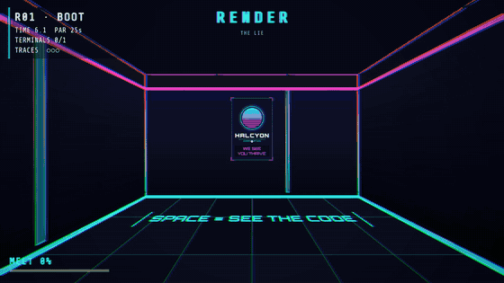
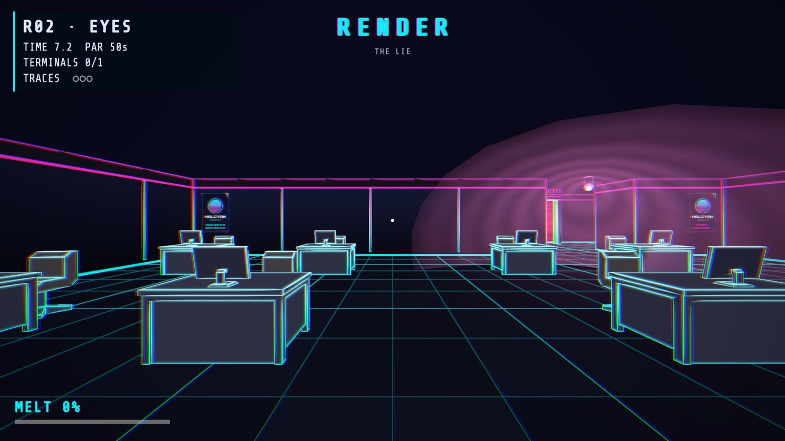
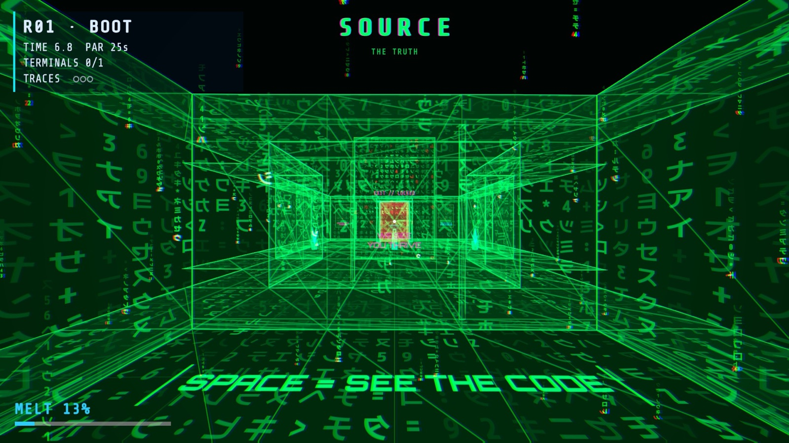
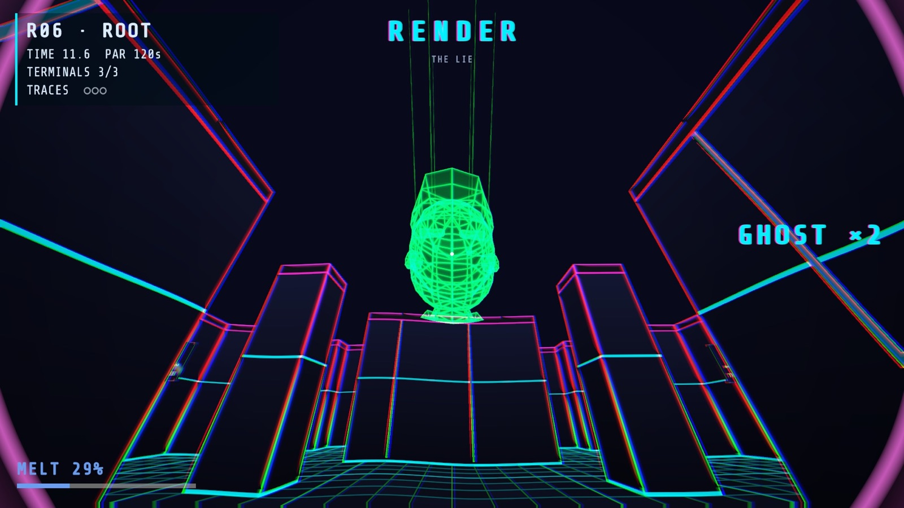

# DESYNC

`SPACE = SEE THE CODE`



> You process tickets at HALCYON Corp. Your city is a render. Your boss is a puppet.

DESYNC is a first-person stealth game with one core verb. Press SPACE and HALCYON's neon office tears into falling green code: walls stop existing, cameras go blind, but hunter-ICE lives in the code and every second there melts your brain. Flip in and out of reality to slip past surveillance, breach terminals, outrun security officers and reach the Architect.

**[Play in the browser](https://desync-nine.vercel.app)** · [Download for macOS / Windows](https://github.com/vj-io/desync-gameathon8/releases/latest) · [Trailer](https://github.com/vj-io/desync-gameathon8/releases/download/v2.0.0/DESYNC-trailer.mp4) · [itch.io](https://vj-io.itch.io/desync)

Gameathon 8.0 entry by team **Kali Mirch** (Vellore Institute of Technology). Unity 6.4, URP, WebGL.

| RENDER, the lie | SOURCE, the truth | The Architect |
| --- | --- | --- |
|  |  |  |

## What's in the game

- **Story mode.** First-time players get a short in-engine story, then guided prompts in Room 1. Thirty story shards hidden across the runs tell the rest. Three endings: Exposed, Merged, and the true ending, Desync.
- **BREACH runs.** A roguelite: three acts on a branching map, rooms generated from hand-made chunks and checked for solvability, and three bosses (AUDITOR, COMPILER, ARCHITECT). Between rooms you draft exploits (58, including duos), shop at the Black Market or rest at a Cooldown node.
- **Enemies.** Cameras, sweepers, drones, ICE hunters and trackers, lanterns, sentinels, splitters, daemons, watcher eyes, and HALCYON security officers who patrol, chase and strike in RENDER.
- **Modes.** Campaign, Quick Breach (one act), Classic (the original six rooms), Daily Breach (one shared seed and one scored attempt a day), Weekly Ladder, Deep Layer (heat levels 1-30), Time-Attack (42 rooms, medals, ghost replays), Endless Overclock.
- **Progression.** Fragments buy an unlock tree of exploit packs, starter archetypes, the Black Market and Time-Attack. Deep Layer pays cosmetic rewards.
- **Accessibility.** Key remapping, Assist mode, colour-blind palette, high contrast, HUD and subtitle size, Reduce FX and Reduce Flashing, separate volume sliders.

## How it plays

Each room is a stealth puzzle: read it, flip to slip past what's watching, breach the terminals, reach the exit.

- **RENDER (the lie):** walls are solid. Cameras and drones see you. Security officers can reach you.
- **SOURCE (the truth):** walls are passable and cameras are blind, but ICE hunters live here.
- **Melt:** fills in SOURCE (+12 %/s, +5 % per flip) and drains in RENDER (−4 %/s). At 100 % you reboot.
- **TRACE:** half a second in a camera cone starts a TRACE. Three TRACEs and the alarm restarts the room.
- **Score:** clean flips build a chain multiplier (up to ×4). Grazing ICE and leaving SOURCE on the brink of melt (REDLINE) pay extra.
- A flip back to RENDER is refused if you would land inside a wall.

## Controls

| Keyboard / mouse | Gamepad | Action |
| --- | --- | --- |
| Mouse | Right stick | Look |
| WASD | Left stick | Move |
| Space | A / South | Flip RENDER ↔ SOURCE |
| E | X / West | Hack a terminal |
| Arrow keys | D-pad | Enter the hack sequence |
| R | — | Restart the room (reroll in a draft) |
| Tab | — | Run map |
| C | — | Copy share text on results |
| 1 / 2 / 3 | — | Pick an exploit in a draft |
| Esc | Start | Pause, settings, key bindings |

Keys can be remapped from the pause menu (Esc always pauses).

## Run it from source

**Requirements:** Unity **6000.4.6f1** (Unity 6.4) with WebGL, macOS and Windows build support. Node 20+ for the browser tests and the leaderboard API. The [Vercel CLI](https://vercel.com/docs/cli) for deploys.

```bash
git clone https://github.com/vj-io/desync-gameathon8.git
cd desync-gameathon8
```

Open the `DESYNC/` folder in Unity Hub. The first import takes a few minutes. Packages, including PrimeTween from OpenUPM, resolve on their own. Press Play in the `Boot` scene.

The scripts in `tools/` run Unity in batch mode. They expect the editor at `/Applications/Unity/Hub/Editor/6000.4.6f1`; change `UNITY=` in `tools/unity.sh` if yours is elsewhere.

| Command | What it does |
| --- | --- |
| `tools/unity.sh compile <tag>` | Compile the project and report errors |
| `tools/test.sh all` | Run every EditMode and PlayMode test; exits non-zero on any failure |
| `tools/build.sh WebRelease` | WebGL build into `Builds/WebRelease` (also `WebDev`, `MacRelease`, `WinRelease`) |
| `tools/e2e.sh` | Browser tests (Playwright) against `Builds/WebRelease` |
| `tools/deploy.sh [--prod]` | Deploy `Builds/WebRelease` and `web/api` to Vercel (a preview unless `--prod`) |

### Deploying to Vercel

`web/site/vercel.json` holds the headers (Brotli `.unityweb`, caching). On a new machine, link the project once:

```bash
cd web/site && vercel link --project desync
```

The online leaderboard (`web/api/leaderboard.ts`) needs a Redis store. Add **Upstash for Redis** to the Vercel project from the Storage tab; it provides `KV_REST_API_URL` and `KV_REST_API_TOKEN`. Without the store, the API answers 503 and the game shows local bests only.

## Project layout

```
DESYNC/              Unity project
  Assets/Scripts/    Core, Rules, Gen, Content, Flow, Player, Enemies, Levels, UI, Audio, Art, Net (one asmdef each)
  Assets/Resources/  Content JSON: exploits, mutators, chunks, bosses, story, shards, unlocks, rooms, hints
web/site/            Vercel site config (the build is copied in on deploy)
web/api/             Leaderboard function and its tests
tests/e2e/           Playwright browser tests
tools/               Unity, build, test and deploy scripts
docs/                Architecture, design decisions, balance, audio, analytics, launch checklist
```

Start with [docs/ARCHITECTURE.md](docs/ARCHITECTURE.md) and [docs/CONTEXT.md](docs/CONTEXT.md). Design decisions are in [docs/DECISIONS.md](docs/DECISIONS.md), and the engineering rules are in [CONTRACT.md](CONTRACT.md).

## Tech

- Unity 6.4 (6000.4.6f1), Universal Render Pipeline 17.4, Input System, AI Navigation (NavMesh), TextMeshPro, PrimeTween.
- Rules, generation and content are engine-free assemblies. All randomness goes through seeded Mulberry32 streams, so a seed always builds the same run.
- Shaders are hand-written URP HLSL. Rooms are built in code from chunk data.
- WebGL with Brotli compression (about 23 MB), hosted on Vercel.
- Tests: about 270 EditMode and 300 PlayMode tests, plus 11 browser tests.

## Credits

Third-party assets, fonts and code, with licences and sources: [CREDITS.md](CREDITS.md). Models, textures and audio are CC0; fonts are SIL OFL; PrimeTween is MIT.

`#Gameathon8 #TheMatrix #BreakTheSimulation`
